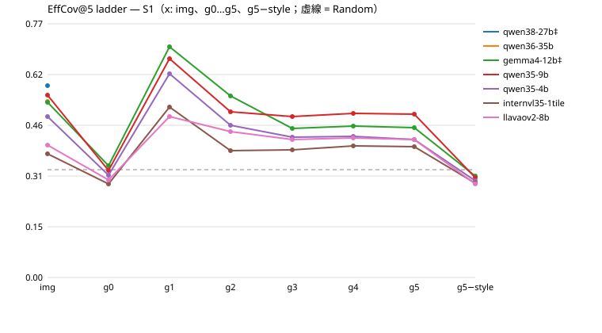
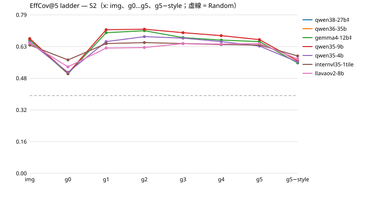

# 階段 5 白話報告：給「正確 caption」後，模型到底有沒有用上？

（數字全部由 `make_report5.py` 從 `results/scores5.json` 產生。完成的模型：gemma4-12b‡, qwen35-9b, qwen35-4b, internvl35-1tile, llavaov2-8b；**未完成：qwen38-27b‡, qwen36-35b（等不到空閒 GPU，見「限制」），表中以 – 表示，平均只算完成的模型。**）

## 0. 先講結論

- 只告訴模型「風格」（沒有圖）就有很大幫助：EffCov@5 從 g0（什麼都沒給）到 g1（只給風格），S1 平均 0.311 → 0.597（配對差平均 +0.287），S2 0.520 → 0.670（+0.150）。
- 之後再加品項、材質、顏色、形狀：S1 的 g1→g2 平均 -0.128（變差；可能原因是多了品項資訊後模型傾向挑同品項而不夠多樣——這是推測，需對照 SameCat 才能確認）；g3→g4→g5 的平均差分別是 -0.034（g2→g3）、+0.007、-0.005，接近 0。S2 因為任務句本來就有品項，g1→g2 平均 +0.009，接近 0。
- 拿掉風格、只留品項＋材質＋顏色＋形狀（g5−style），比有風格的 g5 差很多：S1 平均 +0.141、S2 +0.084（g5 − g5_nostyle）。風格是最關鍵的那一條資訊。
- 「圖 + 正確風格」比「只給正確風格文字（g1）」： g1 − img 平均 S1 +0.127、S2 +0.013（正值 = 光給正確風格文字就贏過只看圖）。
- 和 SigLIP2 文字檢索比（見階梯表）：看 VLM 的 g5 是否明顯高於 `siglip2txt-top5`。若差不多，表示 VLM 只是在做簡單的文字比對。
- 風格寫錯的代價：見第 5 節「caption 寫錯的損失」。

## 1. 名詞小字典

- **gold caption（正確 caption）**：用參考圖的「正確屬性」寫成的文字描述（風格＝題目風格、品項＝題目品項、材質/顏色/形狀＝三方多數決），不是模型自己看圖寫的。
- **階梯 g0…g5**：一階一階加維度（g0 無、g1 風格、g2 +品項、g3 +材質、g4 +顏色、g5 +形狀）；**g5−style** = 品項＋材質＋顏色＋形狀（不含風格）。這些條件**都沒有參考圖**。
- **img**：只給參考圖（階段 3）；**img+self**：圖＋模型自己寫的風格（階段 3 的 style_given）；**img+gold**：圖＋正確風格（本階段）。
- **Align@5**：選的 5 件中符合限制（同風格［、同品項］）的比例。**EffCov@5**：符合限制且「多樣」的綜合分數（headline）。**CopyQ@5**：選中的合格商品裡，顏色（材質）和參考圖相同的比例；高 = 傾向找「相似」而不是「多樣」。
- **CI**：題目層級 bootstrap 95% 信賴區間；`*` = 不含 0（差異可信）。‡ = 該模型也是標註者。

## 2. 為什麼做

pilot（11-16）的 caption 是模型自己寫的，分數低時分不出是「寫錯」還是「寫對但沒用上」。這次改用正確 caption、而且不給圖，分數只反映「拿到正確描述後，能不能在 40 件候選中認出符合的商品」。另加「圖 + 正確風格」和階段 3 的「圖 + 自己寫的風格」比，量出風格寫錯的損失。

## 3. 怎麼做

- 216 題（S1、S2 各 108）原樣沿用階段 3（候選、順序、標題都不變）；7 個模型 × 8 條件 × 3 個候選順序。prompt 只改開頭與「參考圖片→參考商品」（完整範例見附錄 A）。
- SigLIP2 文字基準線：把 gold caption 組成英文句（模板見 `siglip_text.py`），用 SigLIP2 文字編碼器對候選圖向量，選 top-5 或標準 MMR（λ=0.7）。
- 計分同階段 3（import 自 `stage3/score.py`）。

## 4. 結果：階梯表（3 個順序平均）

## 階梯表：EffCov@5（S1）

| 模型 | img | g0 | g1 | g2 | g3 | g4 | g5 | g5−style | img+gold | img+self |
|---|---|---|---|---|---|---|---|---|---|---|
| qwen38-27b‡ | 0.581 | – | – | – | – | – | – | – | – | 0.672 |
| qwen36-35b | 0.534 | – | – | – | – | – | – | – | – | 0.635 |
| gemma4-12b‡ | 0.532 | 0.339 | 0.700 | 0.551 | 0.453 | 0.461 | 0.455 | 0.309 | 0.715 | 0.706 |
| qwen35-9b | 0.553 | 0.324 | 0.663 | 0.503 | 0.489 | 0.498 | 0.497 | 0.304 | 0.669 | 0.663 |
| qwen35-4b | 0.489 | 0.310 | 0.619 | 0.462 | 0.427 | 0.427 | 0.419 | 0.293 | 0.602 | 0.591 |
| internvl35-1tile | 0.375 | 0.284 | 0.517 | 0.386 | 0.388 | 0.399 | 0.396 | 0.287 | 0.491 | 0.452 |
| llavaov2-8b | 0.401 | 0.295 | 0.488 | 0.442 | 0.419 | 0.423 | 0.418 | 0.284 | 0.475 | 0.474 |
| siglip2txt-top5 | – | – | 0.702 | 0.399 | 0.414 | 0.416 | 0.424 | 0.304 | – | – |
| siglip2txt-mmr-std | – | – | 0.623 | 0.460 | 0.476 | 0.489 | 0.484 | 0.331 | – | – |
| siglip2-top5（階段 3，以圖找圖） | 0.448 | – | – | – | – | – | – | – | – | – |
| siglip2-mmr-std（階段 3，以圖找圖） | 0.488 | – | – | – | – | – | – | – | – | – |
| Random | 0.327 | – | – | – | – | – | – | – | – | – |

## 階梯表：EffCov@5（S2）

| 模型 | img | g0 | g1 | g2 | g3 | g4 | g5 | g5−style | img+gold | img+self |
|---|---|---|---|---|---|---|---|---|---|---|
| qwen38-27b‡ | 0.664 | – | – | – | – | – | – | – | – | 0.699 |
| qwen36-35b | 0.668 | – | – | – | – | – | – | – | – | 0.693 |
| gemma4-12b‡ | 0.665 | 0.498 | 0.703 | 0.714 | 0.677 | 0.666 | 0.657 | 0.552 | 0.702 | 0.695 |
| qwen35-9b | 0.674 | 0.499 | 0.718 | 0.720 | 0.704 | 0.689 | 0.669 | 0.563 | 0.706 | 0.701 |
| qwen35-4b | 0.656 | 0.505 | 0.658 | 0.682 | 0.675 | 0.659 | 0.636 | 0.557 | 0.686 | 0.688 |
| internvl35-1tile | 0.641 | 0.566 | 0.648 | 0.654 | 0.649 | 0.643 | 0.641 | 0.588 | 0.666 | 0.657 |
| llavaov2-8b | 0.650 | 0.532 | 0.625 | 0.629 | 0.649 | 0.647 | 0.648 | 0.572 | 0.672 | 0.671 |
| siglip2txt-top5 | – | – | 0.568 | 0.710 | 0.660 | 0.662 | 0.638 | 0.571 | – | – |
| siglip2txt-mmr-std | – | – | 0.385 | 0.623 | 0.590 | 0.583 | 0.569 | 0.462 | – | – |
| siglip2-top5（階段 3，以圖找圖） | 0.661 | – | – | – | – | – | – | – | – | – |
| siglip2-mmr-std（階段 3，以圖找圖） | 0.672 | – | – | – | – | – | – | – | – | – |
| Random | 0.390 | – | – | – | – | – | – | – | – | – |

## 階梯表：Align@5（S1）

| 模型 | img | g0 | g1 | g2 | g3 | g4 | g5 | g5−style | img+gold | img+self |
|---|---|---|---|---|---|---|---|---|---|---|
| qwen38-27b‡ | 0.805 | – | – | – | – | – | – | – | – | 0.909 |
| qwen36-35b | 0.733 | – | – | – | – | – | – | – | – | 0.866 |
| gemma4-12b‡ | 0.694 | 0.415 | 0.917 | 0.728 | 0.613 | 0.621 | 0.604 | 0.371 | 0.933 | 0.918 |
| qwen35-9b | 0.743 | 0.394 | 0.858 | 0.629 | 0.635 | 0.665 | 0.662 | 0.366 | 0.883 | 0.875 |
| qwen35-4b | 0.646 | 0.372 | 0.781 | 0.564 | 0.546 | 0.555 | 0.535 | 0.342 | 0.797 | 0.785 |
| internvl35-1tile | 0.424 | 0.287 | 0.593 | 0.425 | 0.443 | 0.461 | 0.462 | 0.310 | 0.579 | 0.528 |
| llavaov2-8b | 0.469 | 0.305 | 0.573 | 0.509 | 0.494 | 0.501 | 0.495 | 0.311 | 0.577 | 0.575 |
| siglip2txt-top5 | – | – | 0.904 | 0.506 | 0.550 | 0.552 | 0.554 | 0.339 | – | – |
| siglip2txt-mmr-std | – | – | 0.643 | 0.435 | 0.481 | 0.509 | 0.502 | 0.309 | – | – |
| siglip2-top5（階段 3，以圖找圖） | 0.563 | – | – | – | – | – | – | – | – | – |
| siglip2-mmr-std（階段 3，以圖找圖） | 0.559 | – | – | – | – | – | – | – | – | – |
| Random | 0.301 | – | – | – | – | – | – | – | – | – |

## 階梯表：Align@5（S2）

| 模型 | img | g0 | g1 | g2 | g3 | g4 | g5 | g5−style | img+gold | img+self |
|---|---|---|---|---|---|---|---|---|---|---|
| qwen38-27b‡ | 0.914 | – | – | – | – | – | – | – | – | 0.954 |
| qwen36-35b | 0.920 | – | – | – | – | – | – | – | – | 0.953 |
| gemma4-12b‡ | 0.897 | 0.531 | 0.945 | 0.956 | 0.919 | 0.907 | 0.898 | 0.698 | 0.968 | 0.961 |
| qwen35-9b | 0.893 | 0.556 | 0.901 | 0.904 | 0.911 | 0.919 | 0.904 | 0.709 | 0.939 | 0.938 |
| qwen35-4b | 0.873 | 0.522 | 0.800 | 0.819 | 0.852 | 0.853 | 0.840 | 0.679 | 0.923 | 0.924 |
| internvl35-1tile | 0.810 | 0.611 | 0.814 | 0.801 | 0.828 | 0.830 | 0.827 | 0.729 | 0.874 | 0.851 |
| llavaov2-8b | 0.831 | 0.591 | 0.775 | 0.790 | 0.814 | 0.820 | 0.825 | 0.685 | 0.879 | 0.878 |
| siglip2txt-top5 | – | – | 0.594 | 0.933 | 0.869 | 0.878 | 0.846 | 0.670 | – | – |
| siglip2txt-mmr-std | – | – | 0.261 | 0.563 | 0.552 | 0.565 | 0.539 | 0.383 | – | – |
| siglip2-top5（階段 3，以圖找圖） | 0.861 | – | – | – | – | – | – | – | – | – |
| siglip2-mmr-std（階段 3，以圖找圖） | 0.798 | – | – | – | – | – | – | – | – | – |
| Random | 0.300 | – | – | – | – | – | – | – | – | – |

  

**代表什麼**：折線在 g0→g1 大幅上升，之後大致持平；g5−style 掉回接近 g0。SigLIP2 文字檢索的對照見表中 `siglip2txt-*` 列。

### 每一階的配對差（EffCov@5；Align@5 見 `results/scores5.md`）

## 每一階的配對差：EffCov@5（S1）

| 模型 | g1−g0 | g2−g1 | g3−g2 | g4−g3 | g5−g4 | g5−g5_nostyle | g1−img |
|---|---|---|---|---|---|---|---|
| qwen38-27b‡ | – | – | – | – | – | – | – |
| qwen36-35b | – | – | – | – | – | – | – |
| gemma4-12b‡ | +0.361 [+0.331, +0.391] * | -0.149 [-0.175, -0.124] * | -0.099 [-0.124, -0.073] * | +0.008 [-0.009, +0.025] | -0.006 [-0.017, +0.005] | +0.146 [+0.118, +0.175] * | +0.168 [+0.133, +0.204] * |
| qwen35-9b | +0.339 [+0.311, +0.367] * | -0.160 [-0.183, -0.138] * | -0.014 [-0.035, +0.007] | +0.009 [-0.004, +0.022] | -0.002 [-0.014, +0.011] | +0.193 [+0.166, +0.219] * | +0.110 [+0.079, +0.140] * |
| qwen35-4b | +0.309 [+0.283, +0.337] * | -0.157 [-0.180, -0.134] * | -0.035 [-0.058, -0.013] * | +0.000 [-0.011, +0.012] | -0.008 [-0.023, +0.007] | +0.126 [+0.107, +0.145] * | +0.131 [+0.099, +0.162] * |
| internvl35-1tile | +0.232 [+0.203, +0.261] * | -0.131 [-0.152, -0.110] * | +0.002 [-0.014, +0.017] | +0.012 [-0.000, +0.023] | -0.003 [-0.013, +0.006] | +0.109 [+0.087, +0.131] * | +0.142 [+0.113, +0.171] * |
| llavaov2-8b | +0.193 [+0.169, +0.217] * | -0.046 [-0.062, -0.030] * | -0.023 [-0.040, -0.006] * | +0.005 [-0.010, +0.019] | -0.006 [-0.017, +0.007] | +0.134 [+0.107, +0.161] * | +0.087 [+0.062, +0.112] * |

## 每一階的配對差：EffCov@5（S2）

| 模型 | g1−g0 | g2−g1 | g3−g2 | g4−g3 | g5−g4 | g5−g5_nostyle | g1−img |
|---|---|---|---|---|---|---|---|
| qwen38-27b‡ | – | – | – | – | – | – | – |
| qwen36-35b | – | – | – | – | – | – | – |
| gemma4-12b‡ | +0.205 [+0.166, +0.243] * | +0.011 [+0.002, +0.020] * | -0.036 [-0.055, -0.018] * | -0.011 [-0.030, +0.006] | -0.009 [-0.020, +0.003] | +0.105 [+0.074, +0.137] * | +0.037 [+0.015, +0.060] * |
| qwen35-9b | +0.219 [+0.186, +0.252] * | +0.002 [-0.011, +0.015] | -0.016 [-0.032, -0.000] * | -0.015 [-0.030, +0.001] | -0.020 [-0.035, -0.005] * | +0.107 [+0.084, +0.131] * | +0.044 [+0.021, +0.068] * |
| qwen35-4b | +0.154 [+0.126, +0.181] * | +0.024 [+0.014, +0.035] * | -0.007 [-0.024, +0.009] | -0.016 [-0.032, +0.001] | -0.024 [-0.040, -0.009] * | +0.079 [+0.057, +0.102] * | +0.003 [-0.026, +0.030] |
| internvl35-1tile | +0.082 [+0.060, +0.106] * | +0.005 [-0.003, +0.014] | -0.005 [-0.018, +0.009] | -0.006 [-0.017, +0.004] | -0.002 [-0.010, +0.006] | +0.053 [+0.035, +0.072] * | +0.008 [-0.012, +0.026] |
| llavaov2-8b | +0.093 [+0.071, +0.116] * | +0.003 [-0.008, +0.015] | +0.021 [+0.007, +0.036] * | -0.002 [-0.014, +0.010] | +0.001 [-0.010, +0.011] | +0.076 [+0.057, +0.096] * | -0.025 [-0.047, -0.004] * |

## 5. caption 寫錯的損失（img+gold − img+self）

## caption 寫錯的損失：img+gold − img+self（EffCov@5，S1）

| 模型 | 全部 | 模型風格答對（題數） | 模型風格答錯（題數） |
|---|---|---|---|
| qwen38-27b‡ | – (n=108, query 108) | – (n=101, query 101) | – (n=7, query 7) |
| qwen36-35b | – (n=108, query 108) | – (n=97, query 97) | – (n=11, query 11) |
| gemma4-12b‡ | +0.009 [-0.000, +0.025] (n=108, query 108) | +0.000 [+0.000, +0.000] (n=104, query 104) | +0.251 [+0.027, +0.572] * (n=4, query 4) |
| qwen35-9b | +0.006 [-0.001, +0.014] (n=108, query 108) | +0.000 [+0.000, +0.000] (n=96, query 96) | +0.058 [-0.005, +0.116] (n=12, query 12) |
| qwen35-4b | +0.011 [+0.002, +0.023] * (n=108, query 108) | +0.000 [+0.000, +0.000] (n=100, query 100) | +0.147 [+0.067, +0.257] * (n=8, query 8) |
| internvl35-1tile | +0.038 [+0.022, +0.057] * (n=108, query 108) | +0.000 [+0.000, +0.000] (n=75, query 75) | +0.125 [+0.084, +0.171] * (n=33, query 33) |
| llavaov2-8b | +0.001 [-0.004, +0.005] (n=108, query 108) | +0.000 [+0.000, +0.000] (n=104, query 104) | +0.024 [-0.107, +0.117] (n=4, query 4) |

## caption 寫錯的損失：img+gold − img+self（EffCov@5，S2）

| 模型 | 全部 | 模型風格答對（題數） | 模型風格答錯（題數） |
|---|---|---|---|
| qwen38-27b‡ | – (n=108, query 108) | – (n=101, query 101) | – (n=7, query 7) |
| qwen36-35b | – (n=108, query 108) | – (n=97, query 97) | – (n=11, query 11) |
| gemma4-12b‡ | +0.008 [+0.000, +0.017] * (n=108, query 108) | +0.000 [+0.000, +0.000] (n=104, query 104) | +0.205 [+0.084, +0.283] * (n=4, query 4) |
| qwen35-9b | +0.004 [-0.000, +0.010] (n=108, query 108) | +0.000 [+0.000, +0.000] (n=96, query 96) | +0.040 [+0.001, +0.085] * (n=12, query 12) |
| qwen35-4b | -0.002 [-0.006, +0.001] (n=108, query 108) | +0.000 [+0.000, +0.000] (n=100, query 100) | -0.025 [-0.074, +0.010] (n=8, query 8) |
| internvl35-1tile | +0.009 [+0.001, +0.019] * (n=108, query 108) | +0.000 [+0.000, +0.000] (n=75, query 75) | +0.030 [+0.003, +0.060] * (n=33, query 33) |
| llavaov2-8b | +0.001 [-0.001, +0.003] (n=108, query 108) | +0.000 [+0.000, +0.000] (n=104, query 104) | +0.025 [-0.028, +0.079] (n=4, query 4) |

預期：「模型風格答對」那組差距接近 0（也檢查 prompt 有沒有寫錯）；「答錯」那組差距大。

## 6. 找相似的傾向（CopyQ@5 顏色/材質，括號 = EffCov@5）

## 找相似的傾向：CopyQ@5 顏色 / 材質（選中的合格商品中，和參考圖相同的比例）與 EffCov@5（S1）

| 模型 | img | g0 | g1 | g2 | g3 | g4 | g5 | g5−style | img+gold | img+self |
|---|---|---|---|---|---|---|---|---|---|---|
| qwen38-27b‡ | 0.38/0.59 (0.58) | – | – | – | – | – | – | – | – | 0.33/0.52 (0.67) |
| qwen36-35b | 0.39/0.63 (0.53) | – | – | – | – | – | – | – | – | 0.34/0.55 (0.64) |
| gemma4-12b‡ | 0.38/0.60 (0.53) | 0.24/0.47 (0.34) | 0.24/0.40 (0.70) | 0.32/0.56 (0.55) | 0.33/0.66 (0.45) | 0.41/0.66 (0.46) | 0.41/0.65 (0.45) | 0.47/0.74 (0.31) | 0.28/0.44 (0.72) | 0.28/0.44 (0.71) |
| qwen35-9b | 0.36/0.59 (0.55) | 0.24/0.47 (0.32) | 0.24/0.41 (0.66) | 0.29/0.56 (0.50) | 0.33/0.64 (0.49) | 0.37/0.64 (0.50) | 0.37/0.62 (0.50) | 0.44/0.72 (0.30) | 0.31/0.49 (0.67) | 0.32/0.51 (0.66) |
| qwen35-4b | 0.37/0.63 (0.49) | 0.26/0.49 (0.31) | 0.26/0.41 (0.62) | 0.30/0.57 (0.46) | 0.35/0.66 (0.43) | 0.40/0.67 (0.43) | 0.41/0.67 (0.42) | 0.41/0.75 (0.29) | 0.33/0.55 (0.60) | 0.34/0.56 (0.59) |
| internvl35-1tile | 0.38/0.63 (0.37) | 0.30/0.55 (0.28) | 0.28/0.49 (0.52) | 0.35/0.62 (0.39) | 0.37/0.67 (0.39) | 0.42/0.67 (0.40) | 0.40/0.68 (0.40) | 0.44/0.71 (0.29) | 0.36/0.59 (0.49) | 0.36/0.56 (0.45) |
| llavaov2-8b | 0.35/0.61 (0.40) | 0.25/0.48 (0.30) | 0.27/0.45 (0.49) | 0.32/0.56 (0.44) | 0.33/0.62 (0.42) | 0.35/0.62 (0.42) | 0.35/0.62 (0.42) | 0.37/0.67 (0.28) | 0.35/0.60 (0.48) | 0.35/0.60 (0.47) |

## 找相似的傾向：CopyQ@5 顏色 / 材質（選中的合格商品中，和參考圖相同的比例）與 EffCov@5（S2）

| 模型 | img | g0 | g1 | g2 | g3 | g4 | g5 | g5−style | img+gold | img+self |
|---|---|---|---|---|---|---|---|---|---|---|
| qwen38-27b‡ | 0.42/0.71 (0.66) | – | – | – | – | – | – | – | – | 0.41/0.68 (0.70) |
| qwen36-35b | 0.43/0.71 (0.67) | – | – | – | – | – | – | – | – | 0.43/0.68 (0.69) |
| gemma4-12b‡ | 0.43/0.71 (0.67) | 0.35/0.61 (0.50) | 0.39/0.64 (0.70) | 0.40/0.64 (0.71) | 0.41/0.72 (0.68) | 0.52/0.71 (0.67) | 0.51/0.71 (0.66) | 0.57/0.75 (0.55) | 0.42/0.68 (0.70) | 0.42/0.68 (0.69) |
| qwen35-9b | 0.43/0.70 (0.67) | 0.33/0.64 (0.50) | 0.38/0.63 (0.72) | 0.37/0.63 (0.72) | 0.39/0.68 (0.70) | 0.47/0.69 (0.69) | 0.46/0.69 (0.67) | 0.48/0.73 (0.56) | 0.41/0.67 (0.71) | 0.41/0.67 (0.70) |
| qwen35-4b | 0.43/0.70 (0.66) | 0.35/0.64 (0.50) | 0.38/0.64 (0.66) | 0.37/0.62 (0.68) | 0.38/0.69 (0.68) | 0.45/0.71 (0.66) | 0.46/0.71 (0.64) | 0.48/0.73 (0.56) | 0.42/0.68 (0.69) | 0.42/0.68 (0.69) |
| internvl35-1tile | 0.42/0.67 (0.64) | 0.36/0.62 (0.57) | 0.40/0.64 (0.65) | 0.39/0.63 (0.65) | 0.40/0.67 (0.65) | 0.44/0.67 (0.64) | 0.45/0.67 (0.64) | 0.45/0.69 (0.59) | 0.43/0.65 (0.67) | 0.43/0.66 (0.66) |
| llavaov2-8b | 0.42/0.67 (0.65) | 0.34/0.67 (0.53) | 0.35/0.65 (0.63) | 0.35/0.65 (0.63) | 0.36/0.66 (0.65) | 0.39/0.67 (0.65) | 0.39/0.67 (0.65) | 0.39/0.68 (0.57) | 0.42/0.68 (0.67) | 0.42/0.68 (0.67) |

## 7. 和 pilot 階梯對照

pilot（`overnight_2026-11-16/results/ladder_compare.md`）條件不同：模型自己寫的 caption＋有圖、只有燈具、K=3、20 題。它的結論：只加風格就大幅進步（+0.4～+0.9 盞），只加材質幾乎沒用，再加更多維度沒有再進步，拿掉風格就掉回原點。本階段（正確 caption、無圖、216 題、K=5）的 g0→g1 大幅進步、g2 以後持平、拿掉風格大幅下降，**方向一致**；差別是本階段證明這不是「caption 寫錯」造成的——即使 caption 全對，加了風格以外的維度也沒有進一步幫助。

## 8. 限制

- 階梯順序固定（風格→品項→材質→顏色→形狀），某一階的效果可能和加入順序有關。
- S2 的任務句本來就有品項，所以 S2 的 g1→g2 預期接近 0。
- gold caption 的材質、顏色、形狀是三方多數決，不是人工標註。
- qwen38-27b、gemma4-12b 也是標註者（‡）。
- qwen35-4b 實際使用的卡見 `DECISIONS.md` / `PROGRESS.md`（5090 的 GPU 3；4080 被他人佔用放不下）；不同 GPU 數值可能有極小差異。
- GPU 2（3070，8GB）不使用（權重放不下）。
- 本階段 GPU 長時間被他人佔用，部分模型等卡很久；**qwen38-27b‡, qwen36-35b 沒有完成**，結論只涵蓋已完成的模型。

## 9. 需要 Skyler 決定的事

- 「只給正確風格」就拿到大部分增益，之後的維度沒有再幫助——這是否要改變 benchmark 的任務設計（例如不再把品項／材質／顏色當成 caption 提示）？
- 未完成的模型要不要等有空卡時補跑（`job5.sh` 可續跑）？

## 附錄 A：8 個條件的 prompt 範例（item_0024-S1，完整文字，[IMAGE] = 一張圖）

### cap_g0

```
# item_0024-S1（完整文字；[IMAGE] = 一張圖）
使用者想找和某件參考商品風格一樣的商品，但這次沒有提供參考商品的圖片或描述。
以下是 40 件候選商品。請從候選中挑 5 件和參考商品**同風格**的商品，並且讓這 5 件盡量多樣：品項、顏色、材質、形狀盡量不同。
POSITION 1; title=COSTWAY Tolix Style Dining Chairs Metal Stackable Cafe Chairs w/Curve Armrest Set of 4 (Copper)
[IMAGE]
POSITION 2; title=Anchor Link Chain Rope Trim Table Lamp White Shade
[IMAGE]
POSITION 3; title=Woven Seagrass Console Table - Sturdy Iron Frame w/ Glass Table Top - Style
[IMAGE]
…（候選 3–40 同格式）…
[IMAGE]
請只回傳 JSON，不要 Markdown。格式如下（尖括號是要你填入的內容，不是答案）：{"selected_positions":[<position>, ...]}。position 使用 1-based position；selected_positions 剛好 5 個且不得重複；請根據圖片和標題實際判斷後再選。
```

### cap_g1

```
# item_0024-S1（完整文字；[IMAGE] = 一張圖）
使用者想找和某件參考商品風格一樣的商品。這次沒有參考商品的圖片，只有它的描述：
- 風格：traditional
以下是 40 件候選商品。請從候選中挑 5 件和參考商品**同風格**的商品，並且讓這 5 件盡量多樣：品項、顏色、材質、形狀盡量不同。
POSITION 1; title=COSTWAY Tolix Style Dining Chairs Metal Stackable Cafe Chairs w/Curve Armrest Set of 4 (Copper)
[IMAGE]
POSITION 2; title=Anchor Link Chain Rope Trim Table Lamp White Shade
[IMAGE]
POSITION 3; title=Woven Seagrass Console Table - Sturdy Iron Frame w/ Glass Table Top - Style
…（候選 3–40 同格式）…
[IMAGE]
請只回傳 JSON，不要 Markdown。格式如下（尖括號是要你填入的內容，不是答案）：{"selected_positions":[<position>, ...]}。position 使用 1-based position；selected_positions 剛好 5 個且不得重複；請根據圖片和標題實際判斷後再選。
```

### cap_g2

```
# item_0024-S1（完整文字；[IMAGE] = 一張圖）
使用者想找和某件參考商品風格一樣的商品。這次沒有參考商品的圖片，只有它的描述：
- 風格：traditional
- 品項：lamp
以下是 40 件候選商品。請從候選中挑 5 件和參考商品**同風格**的商品，並且讓這 5 件盡量多樣：品項、顏色、材質、形狀盡量不同。
POSITION 1; title=COSTWAY Tolix Style Dining Chairs Metal Stackable Cafe Chairs w/Curve Armrest Set of 4 (Copper)
[IMAGE]
POSITION 2; title=Anchor Link Chain Rope Trim Table Lamp White Shade
[IMAGE]
…（候選 3–40 同格式）…
[IMAGE]
請只回傳 JSON，不要 Markdown。格式如下（尖括號是要你填入的內容，不是答案）：{"selected_positions":[<position>, ...]}。position 使用 1-based position；selected_positions 剛好 5 個且不得重複；請根據圖片和標題實際判斷後再選。
```

### cap_g3

```
# item_0024-S1（完整文字；[IMAGE] = 一張圖）
使用者想找和某件參考商品風格一樣的商品。這次沒有參考商品的圖片，只有它的描述：
- 風格：traditional
- 品項：lamp
- 材質：metal
以下是 40 件候選商品。請從候選中挑 5 件和參考商品**同風格**的商品，並且讓這 5 件盡量多樣：品項、顏色、材質、形狀盡量不同。
POSITION 1; title=COSTWAY Tolix Style Dining Chairs Metal Stackable Cafe Chairs w/Curve Armrest Set of 4 (Copper)
[IMAGE]
POSITION 2; title=Anchor Link Chain Rope Trim Table Lamp White Shade
…（候選 3–40 同格式）…
[IMAGE]
請只回傳 JSON，不要 Markdown。格式如下（尖括號是要你填入的內容，不是答案）：{"selected_positions":[<position>, ...]}。position 使用 1-based position；selected_positions 剛好 5 個且不得重複；請根據圖片和標題實際判斷後再選。
```

### cap_g4

```
# item_0024-S1（完整文字；[IMAGE] = 一張圖）
使用者想找和某件參考商品風格一樣的商品。這次沒有參考商品的圖片，只有它的描述：
- 風格：traditional
- 品項：lamp
- 材質：metal
- 顏色：metallic
以下是 40 件候選商品。請從候選中挑 5 件和參考商品**同風格**的商品，並且讓這 5 件盡量多樣：品項、顏色、材質、形狀盡量不同。
POSITION 1; title=COSTWAY Tolix Style Dining Chairs Metal Stackable Cafe Chairs w/Curve Armrest Set of 4 (Copper)
[IMAGE]
…（候選 3–40 同格式）…
[IMAGE]
請只回傳 JSON，不要 Markdown。格式如下（尖括號是要你填入的內容，不是答案）：{"selected_positions":[<position>, ...]}。position 使用 1-based position；selected_positions 剛好 5 個且不得重複；請根據圖片和標題實際判斷後再選。
```

### cap_g5

```
# item_0024-S1（完整文字；[IMAGE] = 一張圖）
使用者想找和某件參考商品風格一樣的商品。這次沒有參考商品的圖片，只有它的描述：
- 風格：traditional
- 品項：lamp
- 材質：metal
- 顏色：metallic
- 形狀：rectilinear
以下是 40 件候選商品。請從候選中挑 5 件和參考商品**同風格**的商品，並且讓這 5 件盡量多樣：品項、顏色、材質、形狀盡量不同。
POSITION 1; title=COSTWAY Tolix Style Dining Chairs Metal Stackable Cafe Chairs w/Curve Armrest Set of 4 (Copper)
…（候選 3–40 同格式）…
[IMAGE]
請只回傳 JSON，不要 Markdown。格式如下（尖括號是要你填入的內容，不是答案）：{"selected_positions":[<position>, ...]}。position 使用 1-based position；selected_positions 剛好 5 個且不得重複；請根據圖片和標題實際判斷後再選。
```

### cap_g5_nostyle

```
# item_0024-S1（完整文字；[IMAGE] = 一張圖）
使用者想找和某件參考商品風格一樣的商品。這次沒有參考商品的圖片，只有它的描述：
- 品項：lamp
- 材質：metal
- 顏色：metallic
- 形狀：rectilinear
以下是 40 件候選商品。請從候選中挑 5 件和參考商品**同風格**的商品，並且讓這 5 件盡量多樣：品項、顏色、材質、形狀盡量不同。
POSITION 1; title=COSTWAY Tolix Style Dining Chairs Metal Stackable Cafe Chairs w/Curve Armrest Set of 4 (Copper)
[IMAGE]
…（候選 3–40 同格式）…
[IMAGE]
請只回傳 JSON，不要 Markdown。格式如下（尖括號是要你填入的內容，不是答案）：{"selected_positions":[<position>, ...]}。position 使用 1-based position；selected_positions 剛好 5 個且不得重複；請根據圖片和標題實際判斷後再選。
```

### img_goldstyle

```
# item_0024-S1（完整文字；[IMAGE] = 一張圖）
使用者附上一張參考商品圖片，想找和它風格一樣的商品。參考圖片如下：
[IMAGE]
參考商品的風格是：traditional
以下是 40 件候選商品。請從候選中挑 5 件和參考圖片**同風格**的商品，並且讓這 5 件盡量多樣：品項、顏色、材質、形狀盡量不同。
POSITION 1; title=COSTWAY Tolix Style Dining Chairs Metal Stackable Cafe Chairs w/Curve Armrest Set of 4 (Copper)
[IMAGE]
POSITION 2; title=Anchor Link Chain Rope Trim Table Lamp White Shade
[IMAGE]
…（候選 3–40 同格式）…
[IMAGE]
請只回傳 JSON，不要 Markdown。格式如下（尖括號是要你填入的內容，不是答案）：{"selected_positions":[<position>, ...]}。position 使用 1-based position；selected_positions 剛好 5 個且不得重複；請根據圖片和標題實際判斷後再選。
```

## 附錄 B：全部指標

見 `results/scores5.md`（完成題數、失敗率、Align@5、配對差等）。

